<p align="center">
  
</p>

<p align="center">
  Desenvolvedor Back-end · Java & Python<br>
</p>

## Projetos

### 📨 [Microservice_User](https://github.com/GustavoSoaresbcge/Microservice_User) + [Microservice_Email](https://github.com/GustavoSoaresbcge/Microservice_Email)

Dois microsserviços independentes que conversam por **RabbitMQ**. Ao cadastrar um usuário, o serviço *user* publica uma mensagem; o serviço *email* a consome e envia o e-mail de boas-vindas. Cada serviço tem o seu próprio banco.

- 🔁 **Retry** com backoff exponencial (2s, 4s, 8s) e **Dead Letter Queue** para mensagens que esgotaram as tentativas
- 🛠️ **Endpoint de reprocessamento** manual da DLQ
- 🧱 Camadas bem separadas, princípios **SOLID** e **testes unitários** (JUnit 5 + Mockito)
- 🔍 Bug real de integração com o SMTP diagnosticado pela análise dos logs de debug

`Java 21` `Spring Boot` `Spring Data JPA` `RabbitMQ` `PostgreSQL` `Docker` `JUnit 5` `Mockito` `Maven`

### 🎬 [Hashflix](https://github.com/GustavoSoaresbcge/django-streaming-app)

Plataforma web de streaming construída do zero, inspirada na navegação dos serviços de streaming.

- Modelagem relacional de filmes e episódios com **Django ORM**
- **Autenticação completa** com modelo de usuário customizado (cadastro, login, logout e páginas restritas)
- Histórico e contagem de visualizações, busca de conteúdo, Function-Based e Class-Based Views
- Front-end responsivo com Bootstrap 5 e Tailwind CSS (publicado via Railway; hoje desativado)

`Python` `Django` `HTML` `CSS` `JavaScript` `Bootstrap` `Tailwind CSS`

---

## Próximos passos

```bash
$ git log --oneline --next
  testes de integração com Testcontainers
  autenticação com JWT no endpoint de reprocessamento
  idempotência no consumidor de mensagens
  pipeline de CI com GitHub Actions
```

---

## Contato

📩 [gustavosoaresbcge@gmail.com](mailto:gustavosoaresbcge@gmail.com) · 💼 [LinkedIn](https://www.linkedin.com/in/devgustavosoares)
